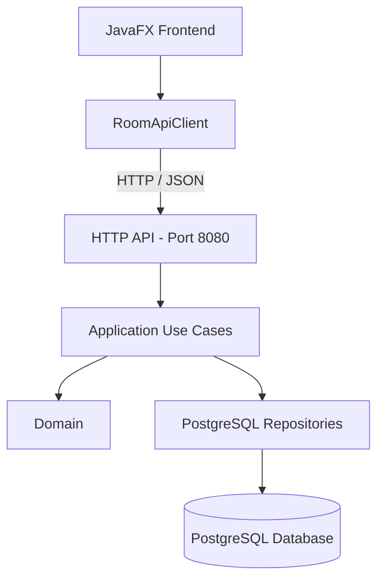
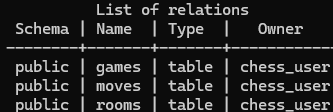
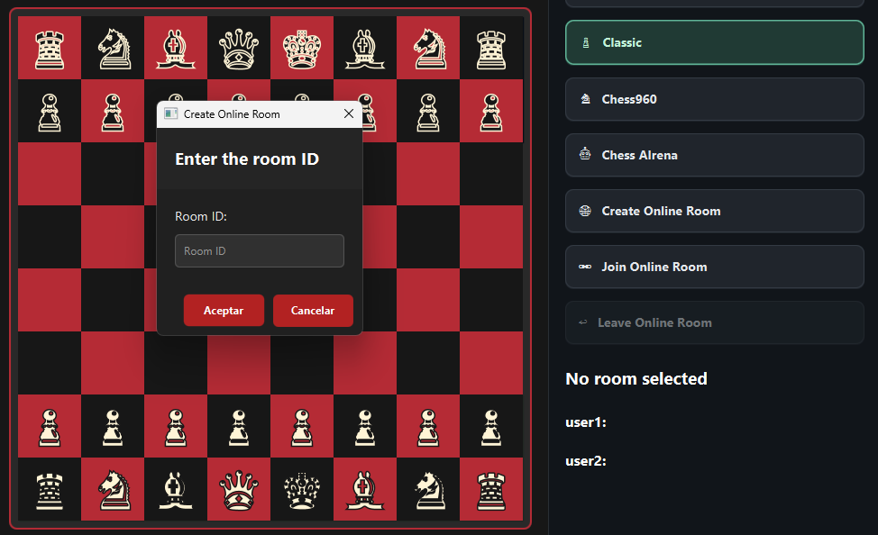
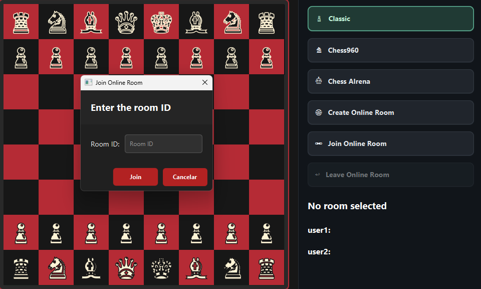
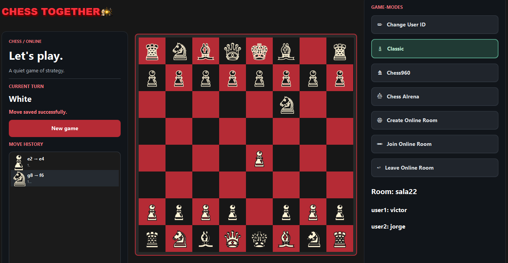
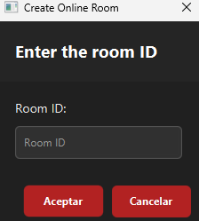
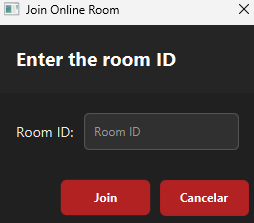
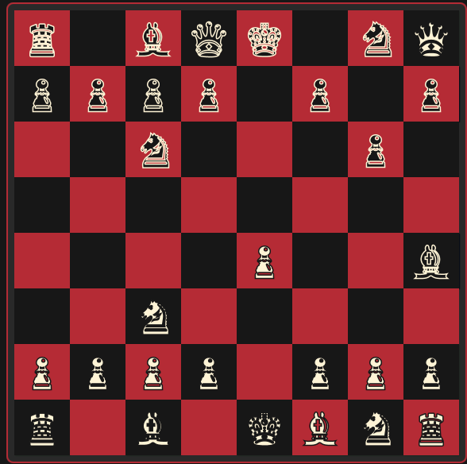
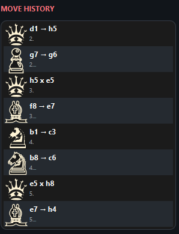

# Chess Together ♟️

**Chess Room Management System**

Software Engineering 2 Project — School of Computer Engineering  
University of Las Palmas de Gran Canaria (ULPGC)

---

## 1. Project Overview

Chess Together is a chess application designed to allow users to create game rooms, join existing rooms, and manage chess games through a client-server architecture.

The system is developed in Java and uses JavaFX for the graphical user interface, an HTTP API for communication between the frontend and backend, and PostgreSQL for persistent data storage.

The main goal is to provide an application where users can share a game room, make moves, and retrieve game information.

### Main Features

- Create chess rooms.
- Join existing rooms using a room code.
- Manage chess games and turns.
- Register and store chess moves.
- Retrieve room and game information.
- Persist rooms and games using PostgreSQL.
- Communicate between frontend and backend through HTTP.
- Graphical user interface developed with JavaFX.

---

## 2. Technologies Used

| Technology | Purpose |
|---|---|
| Java | Main programming language |
| JavaFX | Graphical user interface |
| Maven | Project and dependency management |
| PostgreSQL | Database management |
| JDBC | Database connectivity |
| Java HTTP Server | HTTP server implementation |
| JSON | Data exchange and representation |
| JUnit | Automated testing |
| Docker Compose | Database environment |

**JDK Version:** 25

**JavaFX Version:** 25.0.1

**PostgreSQL Version:** 17

**Additional Dependencies:**
- PostgreSQL JDBC: 42.7.7
- Jackson Databind: 2.20.1
- JUnit 4: 4.13.1
- JUnit Jupiter: 5.12.2

---

## 3. System Architecture

The project follows a client-server architecture and applies Hexagonal Architecture principles to separate the responsibilities of each component.

The system consists of three main components:

1. Frontend: JavaFX graphical application.
2. Backend: HTTP API responsible for managing application operations.
3. Database: PostgreSQL, responsible for persistent storage.

### 3.1. Overall System Architecture



The frontend sends HTTP requests to the backend. The backend processes these requests through its application use cases and uses repositories to store and retrieve information from PostgreSQL.

The frontend does not access the database directly.

### 3.2. Backend Hexagonal Architecture

The backend separates business logic from external communication and persistence mechanisms.

**Domain (`domain/`)**

Contains the entities and rules related to chess and game management.

Main classes include:

- `Board`: represents the chessboard.
- `Game`: represents a chess game.
- `Room`: represents a game room.
- `Piece`: represents chess pieces.
- `Square`: represents board squares.
- `PlayedMove`: represents a played move.
- `MovementRule`: interface defining piece movement rules.
- `CastlingMovementRule`: handles castling movement.
- `AttackDetector`: detects attacked squares.
- `CheckDetector`: detects check situations.
- `CheckmateDetector`: detects checkmate.
- `DrawDetector`: detects draw conditions.
- `KingDetector`: handles king-related detection.
- `MaterialDrawDetector`: detects insufficient material.
- `StalemateDetector`: detects stalemate.
- `GameHistory`: manages position history.
- `PositionKey`: identifies a complete game position.
- `HalfMoveClock`: tracks half-move information.
- `CastlingRights`: stores castling availability.

**Application (`application/`)**

Contains the application's use cases:

- `CreateRoom`: creates new rooms.
- `JoinRoom`: allows users to join existing rooms.
- `GetRoom`: retrieves room information.
- `PlayMove`: executes chess moves.
- `RoomNotFoundException`: handles requests for non-existing rooms.

**Ports (`ports/`)**

Define the interfaces through which the application communicates with external components:

- `GameRepository`
- `RoomRepository`

**Adapters (`adapters/`)**

Implement communication with external systems and infrastructure:

- `launcher/Main`: starts the HTTP server and JavaFX application.
- `desktop/ChessApplication`: JavaFX graphical application.
- `desktop/PieceSprite`: handles chess piece graphics.
- `http/ApiMain`: configures and starts the HTTP server.
- `http/RoomController`: handles incoming HTTP requests.
- `http/RoomApiClient`: sends requests from the frontend to the backend.
- `persistence/PostgresRoomRepository`: room persistence.
- `persistence/PostgresGameRepository`: game persistence.
- `persistence/PostgresConnection`: PostgreSQL connectivity.
- `persistence/BoardStateMapper` and `BoardStateJsonMapper`: transform board states.

### 3.3. Frontend Architecture

The frontend uses JavaFX to display the graphical interface and allow users to interact with the application.

Communication with the backend is handled through an HTTP adapter, preventing the graphical interface from directly managing database operations.

Main classes:

- `adapters.desktop.ChessApplication`: main graphical application.
- `adapters.launcher.Main`: application entry point.
- `adapters.http.RoomApiClient`: HTTP communication with the backend.
- `adapters.desktop.PieceSprite`: graphical representation of chess pieces.

---

## 4. Project Structure

The main source code organization is:

The project follows a modular architecture inspired by Hexagonal Architecture. The code is organized into domain logic, application use cases, ports, and external adapters.

```text
src/
├── main/
│    ├── java/
│    │   └── software/ulpgc/chess/
│    │       │
│    │       ├── domain/
│    │       │   ├── model/
│    │       │   │   └── Core domain entities and value objects
│    │       │   │
│    │       │   ├── rules/
│    │       │   │   ├── movement/
│    │       │   │   │   ├── MovementRule.java
│    │       │   │   │   └── CastlingMovementRule.java
│    │       │   │   │
│    │       │   │   └── detection/
│    │       │   │       ├── AttackDetector.java
│    │       │   │       ├── CheckDetector.java
│    │       │   │       ├── CheckmateDetector.java
│    │       │   │       ├── DrawDetector.java
│    │       │   │       ├── KingDetector.java
│    │       │   │       ├── MaterialDrawDetector.java
│    │       │   │       └── StalemateDetector.java
│    │       │   │
│    │       │   ├── history/
│    │       │   │   ├── GameHistory.java
│    │       │   │   ├── PlayedMove.java
│    │       │   │   ├── PositionKey.java
│    │       │   │   └── HalfMoveClock.java
│    │       │   │
│    │       │   └── state/
│    │       │       └── CastlingRights.java
│    │       │
│    │       ├── application/
│    │       │   └── Application use cases
│    │       │
│    │       ├── ports/
│    │       │   └── Repository interfaces
│    │       │
│    │       └── adapters/
│    │           ├── desktop/
│    │           │   ├── ChessApplication.java
│    │           │   └── PieceSprite.java
│    │           │
│    │           ├── launcher/
│    │           │   └── Main.java
│    │           │
│    │           ├── http/
│    │           │   ├── ApiMain.java
│    │           │   ├── RoomApiClient.java
│    │           │   └── RoomController.java
│    │           │
│    │           └── persistence/
│    │               ├── BoardStateJsonMapper.java
│    │               ├── BoardStateMapper.java
│    │               ├── DatabaseConnection.java
│    │               ├── PostgresConnection.java
│    │               ├── PostgresGameRepository.java
│    │               └── PostgresRoomRepository.java
│    │
│    └── resources/
│        └── software/ulpgc/chess/
│            ├── chess.css
│            └── chess_battle_sprite_7_frames.png
│
│
└── test/
    └── java/
        └── software/ulpgc/chess/
            └── Unit and integration tests

```

---

## 5. Installation and Configuration

### 5.1. Prerequisites

The following software is required:

- JDK 25.
- Apache Maven.
- Docker Desktop with Docker Compose.
- IntelliJ IDEA or another Java-compatible IDE (optional).
- PostgreSQL 17, if running the database without Docker.

### 5.2. Clone the Repository

Clone the repository:

```bash
git clone https://github.com/Galaxy-385/chess-coree-class.git
```

Navigate to the project directory:

```bash
cd chess-coree-class
```

### 5.3. Configure PostgreSQL

The project includes a `docker-compose.yml` file to simplify database startup.

Run the following command from the project root:

```bash
docker compose up -d
```

Check whether the container is running:

```bash
docker compose ps
```

To stop the database container:

```bash
docker compose down
```

**Database Configuration**

The backend supports the following environment variables:

| Variable | Default Development Value |
|---|---|
| DATABASE_URL | jdbc:postgresql://localhost:5432/chess |
| DATABASE_USER | chess_user |
| DATABASE_PASSWORD | chess_local_dev |

These default values are intended only for local development. Development credentials must not be used in a public deployment.

### 5.4. Build the Project

Run the following command from the project root:

```bash
mvn clean compile
```

### 5.5. Run the Tests

```bash
mvn test
```

### 5.6. Run the Application

The main application entry point is:

```text
software.ulpgc.chess.adapters.launcher.Main
```

When `Main` is executed:

1. The HTTP server starts.
2. The API becomes available on port 8080.
3. The JavaFX application starts.
4. When the graphical application closes, the HTTP server is stopped.

The backend can also be started independently by executing:

```text
software.ulpgc.chess.adapters.http.ApiMain
```

---

## 6. Frontend-Backend Communication

Communication between the frontend and backend is performed through HTTP, using JSON as the data exchange format.

The backend uses the Java built-in HTTP server and exposes its operations under the following context:

```text
/rooms
```

The server uses port:

```text
8080
```

Local API address:

```text
http://localhost:8080
```

### 6.1. API Endpoints

| Operation | HTTP Method | Endpoint | Request Body |
|---|---|---|---|
| Create room | POST | `/rooms` | `roomId`, `playerId` |
| Join room | POST | `/rooms/{roomId}/join` | `playerId` |
| Get room | GET | `/rooms/{roomId}` | None |
| Play move | POST | `/rooms/{roomId}/moves` | `playerId`, `from`, `to`, `promotionPiece` |
| Get move history | GET | `/rooms/{roomId}/moves` | None |

**Data format:** JSON.

**HTTP controller:** `RoomController`.

**HTTP client:** `RoomApiClient`.

### 6.2. Error Handling

The system handles situations such as:

- Attempting to access a non-existing room.
- Sending requests with invalid data.
- Attempting moves that are not allowed by the implemented rules.
- Communication errors with the backend.

The API returns JSON error responses using the following HTTP status codes:

| Status Code | Description |
|---|---|
| 400 Bad Request | Invalid arguments or request data. |
| 404 Not Found | Requested room or endpoint does not exist. |
| 409 Conflict | Operation conflicts with the current application state. |
| 500 Internal Server Error | Unexpected internal server error. |

Error responses follow this JSON structure:

```json
{
  "error": "Error description"
}

```

---

## 7. Data Model and Persistence

The application uses PostgreSQL to preserve room and game information.

Persistence is encapsulated through repository adapters implementing the ports defined by the application.

### Main Components

- `PostgresConnection`: establishes database connections.
- `PostgresRoomRepository`: stores and retrieves rooms.
- `PostgresGameRepository`: stores and retrieves games.
- `BoardStateMapper`: transforms board states.
- `BoardStateJsonMapper`: converts board states to and from JSON.

### Database Schema

The database contains three main tables:

- `rooms`: stores room identifiers and the white and black player identifiers.
- `games`: stores the initial and current board states, turn information, castling rights, king and rook starting
           positions, en passant targets, and move counters.
- `moves`: stores the moves played during a game, including move numbers, origin and destination squares,
           promotion pieces, and timestamps.

The relationships between these tables ensure that games belong to rooms and moves belong to games.
Foreign key constraints use `ON DELETE CASCADE` to maintain referential integrity.

### Persistence

The stored information allows rooms and their games to be recovered after restarting the backend.

**Database screenshot:**



---

## 8. Room Management and Player Connection

The project uses game rooms to allow users to share a chess game.

The general workflow is:

1. A user creates a room.
2. The system generates or provides an identifier to access it.
3. Another user uses that identifier to join.
4. Both users share the game managed by the backend.
5. Moves are registered so the game state can be retrieved.

**Room creation screenshot:**



**Room joining screenshot:**



**Two-player game screenshot:**



---

## 9. Original Contribution

The application incorporates a customized graphical interface and a visual representation of chess pieces through project-specific graphical resources.

The implemented elements include:

- A graphical interface developed with JavaFX.
- Customized visual resources for chess pieces.
- A room management system for shared games.
- Persistent storage of rooms and games.
- Separation between domain, application, communication, and persistence.

The main contribution of this project is the integration of a chess application with a persistent room-based multiplayer
architecture.

The system separates chess logic from application use cases, HTTP communication, and database persistence. This makes
the application easier to maintain and allows infrastructure components to be changed independently of the core business logic.

The customized chess interface and sprite-based piece graphics provide a visual identity for the application, while
the backend allows players to share rooms and preserve their game progress.

---

## 10. Application Screenshots

This section contains visual evidence demonstrating the application's functionality.

### 10.1. Chessboard


### 10.2. Room Creation



### 10.3. Joining a Room



### 10.4. Active Game



### 10.5. Game History



---

## 11. Testing and Verification

The project includes automated tests using JUnit to verify the behavior of its components.

Manual tests have also been performed to check the main application workflows.

### Completed Checks

- Room creation.
- Joining existing rooms.
- Move execution.
- Turn validation.
- Room state retrieval.
- Persistence after backend restart.
- Handling invalid requests.
- HTTP server shutdown when the JavaFX application closes.

### Test Results

**Total automated tests:** 256 tests

**Build result:** SUCCESS

**Manual verification:** Room creation, joining, move execution, turn validation, room retrieval,
                         persistence after backend restart, invalid request handling, and HTTP server
                         shutdown were manually verified.


---

## 12. Known Limitations

This section must describe the actual limitations of the submitted version.

- Implemented chess rules: [SPECIFY].
- Unsupported rules or situations: [SPECIFY].
- User management: [SPECIFY].
- Concurrent player handling: [SPECIFY].
- Communication between different computers: [SPECIFY].
- Network and configuration requirements: [SPECIFY].

The README should not claim support for features that have not been implemented and verified.

---

## 13. Video Demonstration (Optional)

The project assignment does not require an explanatory video. However, a short demonstration can be included as supplementary material.

[INSERT A LINK TO A DEMONSTRATION VIDEO, IF AVAILABLE]

---

## 14. Author

**Author:** [FULL NAME]

**Degree:** Computer Engineering

**School:** School of Computer Engineering

**University:** University of Las Palmas de Gran Canaria

**Course:** Software Engineering 2

**Academic Year:** [ACADEMIC YEAR]

---

## 15. License

[SPECIFY THE PROJECT LICENSE, IF ONE HAS BEEN DEFINED.]
